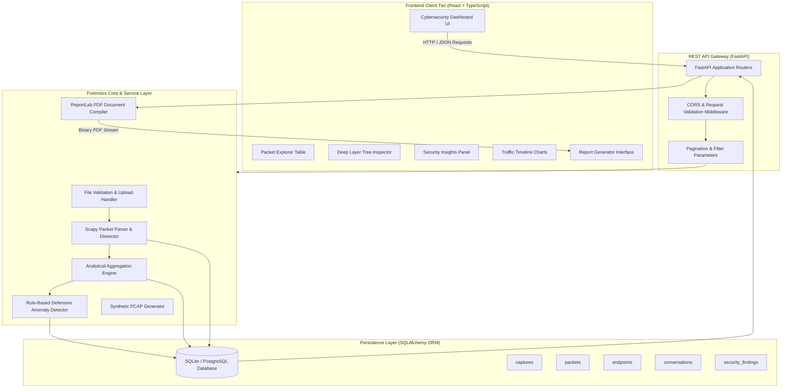

# Chapter 6: System Architecture

## 6.1 Architectural Overview
The platform employs a decoupled, multi-tier client-server architecture designed for high maintainability, fast asynchronous packet dissection, and clean separation of concerns.

## 6.2 Data Processing Pipeline
1. **Ingestion & Validation:** A `.pcap` or `.pcapng` capture is uploaded via the web interface. The server validates file headers, file extensions, and file sizes.
2. **Layer Demultiplexing:** `Scapy` sequentially reads wire frames using `PcapReader`, extracting Layer 2 (Ethernet/ARP), Layer 3 (IPv4/IPv6), Layer 4 (TCP/UDP/ICMP), and Layer 7 (DNS/HTTP/TLS) metadata.
3. **Hierarchical Serialization:** Each packet is dissected into an expandable JSON tree (`layers_json`) containing all protocol fields, ready for the frontend inspector.
4. **Statistical Correlation:** The `AnalysisEngine` aggregates bidirectional 5-tuple conversations and calculates IP endpoints, scope (private vs public), and port associations.
5. **Heuristic Anomaly Detection:** The `SecurityAnalyzer` evaluates traffic against defensive anomaly rules, outputting evidence-backed security findings with severity ratings.
6. **Persistence & Presentation:** Structured entities are committed to the database in bulk transactions. The React frontend visualizes statistics through responsive charts and interactive tables.
