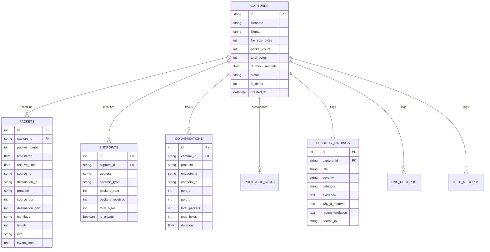

# Chapter 9: Database Design

## 9.1 Entity Relationship Model
The data model is implemented via SQLAlchemy ORM, fully compatible with SQLite (default local file) and PostgreSQL (production).

## 9.2 Database Indexes
To maintain responsive queries across captures with thousands of frames:
- `packets`: Index on `(capture_id, packet_number)` and `(capture_id, protocol, source_ip, destination_ip)`.
- `endpoints`: Index on `(capture_id, address)`.
- `conversations`: Index on `(capture_id, endpoint_a, endpoint_b)`.
- `security_findings`: Index on `capture_id`.
